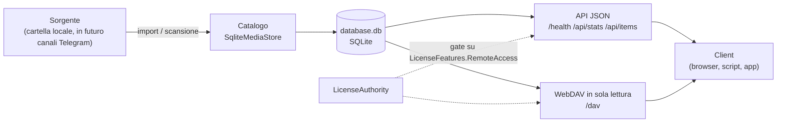

# Architettura

Documento di riferimento per chi mette mano al codice. Descrive come i pezzi si parlano, dove
vivono i dati e quali punti sono deliberatamente lasciati aperti.

## Flusso dei dati

Il verso è unico: la sorgente alimenta il catalogo, il catalogo alimenta il database, il server legge
il database e non lo modifica mai. La scrittura avviene solo attraverso i comandi di import e le
operazioni esplicite. Così l'area WebDAV può restare in sola lettura per costruzione, non per
convenzione.

## Componenti

| Componente | Ruolo |
|---|---|
| `Teledisk.Core.Domain` | Tipi del dominio: `Channel`, `MediaItem`, `MediaKind`, `ChannelKind`. |
| `Teledisk.Core.Infrastructure.TelediskPaths` | Unica fonte dei percorsi; tutto ciò che è scrivibile deriva da `Root`. |
| `Teledisk.Core.Abstractions` | `TelediskSettings` e `ISettingsStore`: impostazioni tipizzate, nessun percorso scritto nel codice. |
| `Teledisk.Core.Settings.JsonSettingsStore` | Persistenza su JSON con scrittura atomica (file temporaneo e sostituzione). |
| `Teledisk.Core.Security` | `PasswordHasher` (PBKDF2-HMAC-SHA256, formato versionato) e `SecretBox` (AES-256-GCM). |
| `Teledisk.Data.TelediskDatabase` | Apertura del database, migrazioni versionate in transazione, `PRAGMA integrity_check`. |
| `Teledisk.Data.SqliteMediaStore` | Lettura e scrittura del catalogo, ricerca e statistica. |
| `Teledisk.Server.TelediskServer` | Server HTTP: API JSON e area WebDAV in sola lettura. |
| `Teledisk.Licensing` | Documento, envelope, firma, verifica, chiavi fidate, entitlement effettivo. |
| `Teledisk.Media` | Contratto dei provider di metadati (`IMediaScraper`), registro e client TMDB. |
| `Teledisk.Cli` | Comandi `machine`, `doctor`, `db`, `settings`, `scan`, `backup`, `serve`, `license`. |

## Percorsi dati

Tutti i percorsi derivano da un'unica radice, `TelediskPaths.Root`. La radice si risolve in
quest'ordine:

1. variabile `TELEDISK_HOME`, se impostata;
2. `%APPDATA%\Teledisk` su Windows, `~/.local/share/Teledisk` altrove.

| Percorso | Contenuto |
|---|---|
| `<radice>/database.db` | Catalogo, canali, code di trasferimento, backup, log applicativi. |
| `<radice>/settings.json` | Impostazioni dell'utente. |
| `<radice>/license.tlicense` | Licenza opzionale dell'installazione. |
| `<radice>/keys/trusted/` | Chiavi pubbliche aggiuntive di cui fidarsi. |
| `<radice>/backups/` | Archivi con nome `teledisk-<data>_<ora>.zip`. |
| `<radice>/cache/` | Copertine e anteprime. |
| `<radice>/logs/` | Log applicativi. |

Le cartelle vengono create da `TelediskPaths.EnsureCreated`, invocato dai comandi prima di qualunque
scrittura. Il bundle dell'applicazione resta di sola lettura, come nell'originale: nessun dato
dell'utente finisce nella cartella di installazione.

## Database

SQLite locale, un file per installazione, modalità WAL. La versione dello schema è in
`PRAGMA user_version` e le migrazioni sono idempotenti e applicate in una sola transazione:
un'interruzione lascia il database alla versione precedente, mai a metà.

| Tabella | Contenuto |
|---|---|
| `channels` | Canali o cartelle di origine della libreria. |
| `media_items` | Voci del catalogo, legate al canale dalla coppia `channel_id`/`message_id`. |
| `transfer_jobs` | Code di trasferimento (campi pronti per download e upload). |
| `backups` | Backup eseguiti. |
| `logs` | Eventi applicativi per livello e ambito. |

`TelediskDatabase.CheckIntegrity` espone `PRAGMA integrity_check`; `teledisk db` lo richiama e
restituisce `2` se il database non è sano, così un controllo automatico può accorgersene.

## Server

Il server si costruisce con `TelediskServer.Build` e si avvia con `RunAsync`; la CLI lo espone come
`teledisk serve`, e il progetto `Teledisk.Server` ha un `Program` autonomo per lo sviluppo.

| Rotta | Metodo | Autenticazione | Risposta |
|---|---|---|---|
| `/health` | GET | nessuna | stato, tier, funzionalità, versione schema |
| `/api/stats` | GET | Bearer, se `--token` è impostato | conteggi di elementi, byte e canali |
| `/api/items` | GET | Bearer, se `--token` è impostato | voci del catalogo, filtri `q`, `kind`, `limit` |
| `/dav/...` | `OPTIONS`, `PROPFIND`, `HEAD`, `GET` | Basic, se l'hash della password è impostato | elenco e intestazioni delle voci |

Il bind predefinito è `127.0.0.1`; `0.0.0.0` accetta la rete. Il gate di licenza su
`LicenseFeatures.RemoteAccess` è verificato all'avvio e, quando il bind esce dal loopback e il flag
manca, produce un avviso nel log invece di rifiutare le richieste. Oggi `DefaultFeatures` restituisce
sempre tutti i flag, quindi il gate non scatta mai; la struttura resta pronta.

L'area WebDAV parla il minimo indispensabile di DAV per i client di libreria (rclone, Jellyfin,
Emby): `OPTIONS`, `PROPFIND` con `multistatus`, `HEAD`, `GET`. Il corpo di `GET` è ancora vuoto: il
server espone metadati e dimensioni, non i byte, che nell'originale arrivano dal client Telegram.

## Impostazioni e segreti

`TelediskSettings` è un record immutabile: le modifiche passano da `with` e da un salvataggio
completo, così il file non si trova mai in stati intermedi incoerenti. La scrittura è atomica.

Le password non si memorizzano in chiaro: `PasswordHasher` produce
`pbkdf2-sha256$iterazioni$salt$hash`, verificabile a tempo costante. I valori da cifrare (per
esempio il numero di telefono associato a una sessione) passano da `SecretBox`, che usa AES-256-GCM
con nonce per ogni valore e stringa autodescrittiva `v1$nonce$tag$payload`.

## Punti aperti

- Client Telegram MTProto e bot: i progetti `Teledisk.Telegram` e `Teledisk.Backup` esistono come
  contenitori, la logica vera è ancora nella CLI e in `Core`.
- Il comando `scan` importa da cartella locale; la scansione di un canale Telegram arriverà quando
  ci sarà il client.
- `Teledisk.Media` ha il contratto e il client TMDB, non ancora richiamati dai comandi.
- Nessuna interfaccia grafica: la CLI è l'unico punto di ingresso.
